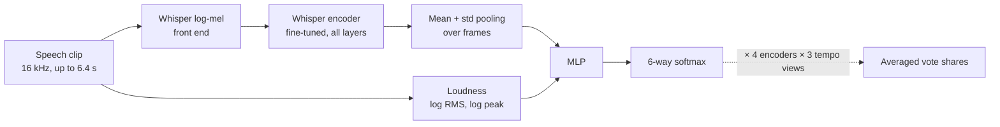

# Perceived Emotion from Speech

Predict **how a panel of listeners splits its votes** over six emotions (anger, disgust, fear,
happy, neutral, sad) from a short speech clip alone.

This is harder than ordinary emotion classification. The label is what people *heard*, not the
emotion the speaker was asked to act, and listeners disagree a lot: on about half of the clips the
acted emotion is not even the most common vote. So the model predicts a full probability
distribution and is trained to match the whole split of votes.

**Result:** a skill score of **0.557** on a held-out test set of 1,556 clips from speakers never
seen in training (0 = no better than always predicting the average split, 1 = perfect).

## How it works



- **Pretrained speech encoders, fine-tuned end to end.** Whisper is trained for speech
  recognition and has never seen emotion labels, but its encoder hears tone and prosody well. Only
  the encoder is kept: no text is ever produced.
- **The loss is the metric.** Training minimises the Jensen-Shannon divergence between the
  predicted distribution and the listeners' vote shares, so the model learns *how* votes split,
  including which emotions people confuse.
- **Layer-wise learning-rate decay** (0.9 per layer) keeps the lower, general-purpose layers close
  to their pretrained weights while the top layers adapt.
- **Short training.** The encoders memorise a few thousand clips quickly, so each model trains for
  just 4 epochs (warm-up, then cosine decay) in bf16.
- **An ensemble of different encoders.** `whisper-large-v3`, `whisper-large`, `whisper-medium` and
  `whisper-medium.en` are trained one after another and averaged. Different pretrained encoders
  make different mistakes, which helped much more than extra random seeds of one model.
- **Test-time views.** Each test clip is also played 5% faster and 5% slower, and the three
  predictions are averaged.

## Results

All validation numbers use 3 folds split **by speaker**, so a model can never score by
recognising a voice it was trained on.

| Model | Validation score |
| --- | --- |
| Constant: always predict the average split | 0.000 |
| WavLM-large, fine-tuned *(fold 0 only)* | 0.470 |
| whisper-medium | 0.518 |
| whisper-large-v3 | 0.526 |
| whisper-medium + whisper-medium.en | 0.529 |
| **4-encoder ensemble (final)** | **0.537** |
| **Final model on the held-out test set** | **0.557** |

Tried and dropped, because they did not help on validation: WavLM and other encoder families,
smaller Whisper sizes, a learned mix of all encoder layers, attentive pooling, encoder dropout,
SpecAugment-style mel masking, mixup, weight averaging, speed resampling during training, longer
training, an extra cross-entropy loss, and a fitted sharpening exponent. A second seed of the same
encoder changed the score by about 0.003, a third of what a *different* encoder added.

### The metric

```
score = 1 - mean(JSD(predicted, true) ^ 0.75) / mean(JSD(average split, true) ^ 0.75)
```

JSD is measured in bits. Raising each clip's divergence to 0.75 keeps a few very ambiguous clips
from dominating the average. See [`evaluate.py`](evaluate.py).

## Quick start

```sh
pip install -r requirements.txt

# try it on a tiny synthetic dataset (tones, not speech: checks the code runs, nothing more)
python make_toy_data.py toy_data
python train.py toy_data toy_pred.csv --encoders openai/whisper-tiny --epochs 1
python evaluate.py toy_data/test_labels.csv toy_pred.csv

# the full model on real data
python train.py path/to/data predictions.csv
```

`train.py --help` lists every setting: encoders, epochs, batch size, learning rates and seed.

### Compute

The full four-encoder run trains and predicts in about **50 minutes on one 24 GB GPU** (RTX 3090 /
A10G), peaking at 15 GB of GPU memory. Each batch runs in two halves with summed gradients, which
gives the same update with half the activation memory. The pretrained weights (about 15 GB) download
from Hugging Face on the first run. A single `whisper-medium` takes about 10 minutes and scores
roughly 0.02 lower.

## Data format

The dataset is not included. The code expects a folder like this:

```
data/
├── train.csv     id, audio, anger, disgust, fear, happy, neutral, sad
├── test.csv      id, audio
└── audio/        16 kHz mono 16-bit WAV files, up to 6.4 s each
```

- `audio` is the path of the WAV file, relative to the data folder.
- The six emotion columns are the share of listener votes for each emotion, and sum to 1.
- The output CSV has `id` and the six predicted shares, written to 6 decimal places and summing
  to exactly 1.

The model was developed on about 7,400 clips of actors reading single English sentences, each rated
by a panel of listeners who heard the audio without video, with realistic background noise added.
Training and test speakers do not overlap. [CREMA-D](https://github.com/CheyneyComputerScience/CREMA-D)
is a public corpus that includes this kind of audio-only listener rating, and can be converted to
this format.

## Files

| File | |
| --- | --- |
| [`train.py`](train.py) | Fine-tunes the encoders and writes test predictions |
| [`evaluate.py`](evaluate.py) | The skill score above |
| [`make_toy_data.py`](make_toy_data.py) | Writes a small synthetic dataset for a quick check |

## License

[MIT](LICENSE). The Whisper weights are released by OpenAI under the MIT license.
